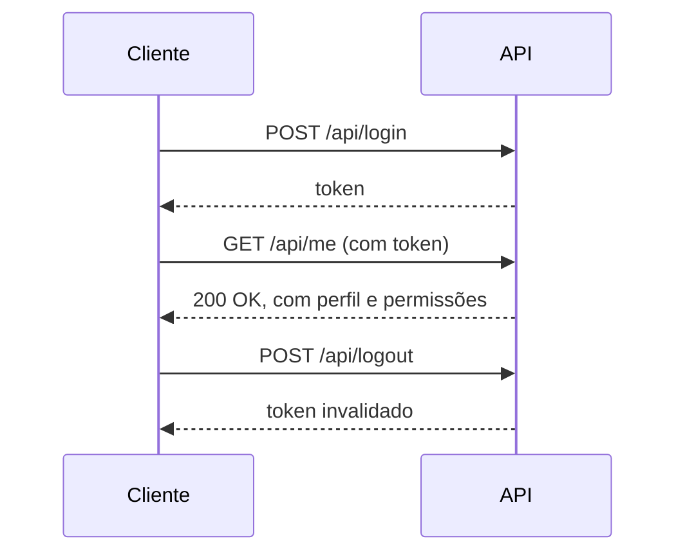

<div align="center">

# 🚗 MyCar API

### API REST para gestão de frotas, com oficinas e cuidados com o carro

Um único backend Laravel que atende quatro perfis, cada um com seus dados e suas telas. O foco principal é a **MyCar Frota**.


**Backend** · [Frontend (React)](https://github.com/joaoalexandre2/mycar_frontend)

</div>

---

## 🧩 Os produtos

Cada conta escolhe um perfil no cadastro (`POST /api/register` com `perfil`). Os dados de um perfil não se misturam com os de outro.

### 🚚 MyCar Frota (`frota`)

Produto principal. Para empresas com veículos, do controle de reservas à prestação de contas:

- **Agenda de reservas:** quem usa cada veículo, quando e para quê, com aviso de conflito de horário.
- **Saída e chegada:** registro do uso com km e foto do hodômetro, checklist de saída e de devolução.
- **Motoristas:** cadastro com CNH e validade, centro de custo padrão e convite para acessar o sistema.
- **Centros de custo:** cada uso sai em um centro, com histórico das trocas e motivo obrigatório.
- **Pessoas e grupos:** papéis de administrador, gestor e motorista, e grupos que liberam menus e permissões extras.
- **Importação de planilha:** histórico de viagens em CSV, conferido antes de gravar.
- **Ocorrências, multas, financeiro e relatórios:** acompanhamento do que acontece com cada veículo.
- **Trilha de mudanças:** correções e acessos ficam registrados com quem fez e o motivo.

### 🛠️ MyCar Oficina (`oficina`)

Oficinas: clientes, veículos, ordens de serviço, manutenções e peças.

### 🚗 MyCar Cuidados com seu carro (`pessoa`)

Dono de carro: valor, IPVA, licenciamento, seguro, abastecimento, documentos e fotos.

### ✨ MyCar Estética Automotiva (`estetica`)

Estética automotiva: pátio em etapas, serviços e pacotes, histórico por placa e financeiro.

Uma mesma conta pode ter mais de um MyCar (por exemplo, oficina e frota). O MyCar principal fica nas colunas do usuário; os extras ficam na tabela `acessos`.

## 🧱 Como o isolamento funciona

- **Oficina:** os dados ficam ligados a `oficina_id` (trait `PertenceAOficina`).
- **Pessoa e frota:** os dados ficam ligados a `conta_id` (trait `PertenceAConta`).
- Os models falham fechado: sem a conta ou a oficina atual, nada é retornado.
- O middleware `perfil:...` responde `403` com mensagem clara quando a rota não é do perfil do usuário.
- Na frota, o middleware `papel` (administrador, gestor) e `permissao` (grupos de usuários) restringem cada bloco de rotas.

## 🔐 Autenticação



- O cadastro envia um e-mail de confirmação; o login só funciona depois de confirmado.
- Login e cadastro têm limite de tentativas (`throttle`).
- Todas as rotas, exceto as de autenticação e cadastro, exigem o token no cabeçalho `Authorization: Bearer <token>`.

## 🛣️ Endpoints (visão geral)

A lista completa, com parâmetros e respostas, está na documentação Swagger em `/api/docs` (gerada a partir de `storage/api-docs/api-docs.json`).

| Grupo | Prefixo | Perfil |
|---|---|---|
| Autenticação e cadastro | `/api/login`, `/api/logout`, `/api/register`, `/api/me` | todos |
| Vários MyCar por e-mail | `/api/meus-mycars` | todos |
| Oficina | `/api/clientes`, `/api/veiculos`, `/api/ordens-servico`, `/api/manutencoes`, `/api/oficina` | `oficina` |
| Conta (veículos, despesas, documentos, fotos, abastecimento, seguros) | `/api/conta/...` | `pessoa`, `frota` |
| Frota (usos, motoristas, centros de custo, pessoas, grupos) | `/api/conta/usos`, `/api/conta/motoristas`, `/api/conta/centros-custo`, `/api/conta/pessoas`, `/api/conta/grupos-usuarios` | `frota` |
| FIPE | `/api/fipe/...` | todos |
| Operador (contas e acessos) | `/api/admin/...` | operador do sistema |

## 🚀 Começando

### Pré-requisitos

- PHP 8.2+
- Composer
- Node.js (para o build de assets)

### Instalação

```bash
git clone https://github.com/joaoalexandre2/mycar.git
cd mycar
composer setup
```

O `setup` instala as dependências, cria o `.env`, gera a chave, roda as migrations e faz o build.

<details>
<summary>Instalação manual</summary>

```bash
composer install
cp .env.example .env
php artisan key:generate
touch database/database.sqlite
php artisan migrate
npm install
```

</details>

### Variáveis de ambiente

As principais estão em `.env.example`:

| Variável | Para que serve |
|---|---|
| `APP_URL` | Endereço público da API |
| `FRONTEND_URL` | Endereço do frontend, usado nos links de e-mail |
| `DB_CONNECTION` | Banco de dados (padrão: `sqlite` em desenvolvimento) |
| `MAIL_MAILER` | Envio de e-mails (confirmação de cadastro, lembretes e resumos) |

> ⚠️ Em ambiente de desenvolvimento, `php artisan migrate:fresh` apaga o banco. Não use em um banco com dados reais.

### Executando

```bash
php artisan serve
```

A API fica em `http://localhost:8000/api`. Para subir servidor, fila, logs e Vite juntos:

```bash
composer dev
```

## 🧪 Testes

```bash
composer test
```

Os testes são de feature, rodam contra o banco de testes e cobrem os três perfis, o isolamento entre contas e as permissões da frota.

## 📚 Documentação

- Swagger (OpenAPI): `/api/docs` em um ambiente rodando.

## 🔗 Frontend

O front-end React está em [joaoalexandre2/mycar_frontend](https://github.com/joaoalexandre2/mycar_frontend). Ele tem as telas dos três perfis e lê o perfil em `/api/me` ao abrir.

## 📄 Licença

MIT

---

<div align="center">
Feito com ☕ por <a href="https://github.com/joaoalexandre2">João Alexandre</a>
</div>
